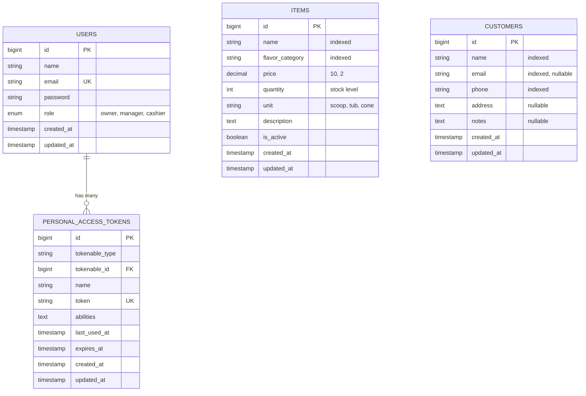

# Creamy - Ice Cream Shop Management System (Backend API)

> **Delivergate Backend Engineer Intern Practical Exam — Option B (Laravel with MySQL)**

A production-ready RESTful backend API built with **Laravel 11+**, **MySQL**, and **Laravel Sanctum**. This application manages inventory items across ice cream flavor categories and customer records, enforced with strict **Role-Based Access Control (RBAC)** for **Owner**, **Manager**, and **Cashier** roles.

---

## 📋 Table of Contents
1. [Business Overview](#-business-overview)
2. [Role-Based Access Control (RBAC) Matrix](#-role-based-access-control-rbac-matrix)
3. [Pre-Seeded User Accounts](#-pre-seeded-user-accounts)
4. [System Architecture & Code Structure](#-system-architecture--code-structure)
5. [Database Design & ER Diagram](#-database-design--er-diagram)
6. [Prerequisites & Installation](#-prerequisites--installation)
7. [Running the Application](#-running-the-application)
8. [Automated Testing Suite](#-automated-testing-suite)
9. [API Documentation & Endpoints](#-api-documentation--endpoints)
10. [Postman API Collection](#-postman-api-collection)
11. [Technical Decisions & Assessment Q&A](#-technical-decisions--assessment-qa)

---

## 🍨 Business Overview

An ice cream parlor sells various flavors grouped into categories (e.g., Chocolate, Vanilla, Strawberry, Fruit/Sorbet, Mint). The shop requires a reliable system to:
1. **Manage Inventory Items**: Track item names, flavor categories, pricing, unit quantities (scoops, tubs), availability, and search items by name or filter by category.
2. **Manage Customer Records**: Track customer contact info, addresses, and special preferences (e.g., dietary allergies, preferred flavors).
3. **Enforce Role-Based Access Control (RBAC)**: Different store members have strictly defined privileges.

---

## 🛡️ Role-Based Access Control (RBAC) Matrix

| Resource & Action | HTTP Method & URI | Owner | Manager | Cashier | Assessment Rule |
|---|---|:---:|:---:|:---:|---|
| **Auth: Login** | `POST /api/auth/login` | ✅ | ✅ | ✅ | Issues bearer token |
| **Auth: Logout** | `POST /api/auth/logout` | ✅ | ✅ | ✅ | Revokes bearer token |
| **Auth: Profile** | `GET /api/auth/me` | ✅ | ✅ | ✅ | Current user profile |
| **Items: List** | `GET /api/items` | ✅ | ✅ | ✅ | Supports `?search=` and `?category=` |
| **Items: Show** | `GET /api/items/{id}` | ✅ | ✅ | ✅ | View item details |
| **Items: Create** | `POST /api/items` | ✅ | ✅ | ❌ *(403)* | Cashier cannot add new items |
| **Items: Update** | `PUT/PATCH /api/items/{id}` | ✅ | ✅ | ✅ | Cashier can update existing items (e.g. stock) |
| **Items: Delete** | `DELETE /api/items/{id}` | ✅ | ❌ *(403)* | ❌ *(403)* | Only Owner can delete items |
| **Customers: List** | `GET /api/customers` | ✅ | ✅ | ✅ | Supports `?search=` |
| **Customers: Show** | `GET /api/customers/{id}` | ✅ | ✅ | ✅ | View customer details |
| **Customers: Create** | `POST /api/customers` | ✅ | ✅ | ✅ | All roles can register customers |
| **Customers: Update** | `PUT/PATCH /api/customers/{id}` | ✅ | ✅ | ✅ | All roles can edit customers |
| **Customers: Delete** | `DELETE /api/customers/{id}` | ✅ | ❌ *(403)* | ❌ *(403)* | Only Owner can delete customers |

---

## 👥 Pre-Seeded User Accounts

The database seeder automatically provisions test accounts for each role with known credentials:

| Role | Email Address | Password | Permissions Summary |
|---|---|---|---|
| **Owner** | `owner@delivergate.com` | `Password123!` | Full control over inventory items and customer records (CRUD). |
| **Manager** | `manager@delivergate.com` | `Password123!` | Can add, view, and edit items and customers; **cannot delete** either. |
| **Cashier** | `cashier@delivergate.com` | `Password123!` | Can view and edit items (adjust stock), can add/view/edit customers; **cannot add/delete items, cannot delete customers**. |

---

## 🏗️ System Architecture & Code Structure

The application strictly follows Laravel best practices, the Single Responsibility Principle (SRP), and clean layer separation:

```
Creamy/
├── app/
│   ├── Enums/
│   │   └── UserRole.php              # Backed Enum: 'owner', 'manager', 'cashier'
│   ├── Http/
│   │   ├── Controllers/
│   │   │   ├── Api/
│   │   │   │   ├── AuthController.php      # Login, logout, current user profile
│   │   │   │   ├── ItemController.php      # Inventory items CRUD & search
│   │   │   │   └── CustomerController.php  # Customer records CRUD & search
│   │   │   └── Controller.php
│   │   ├── Requests/
│   │   │   ├── Auth/LoginRequest.php            # Validates email & password
│   │   │   ├── Item/StoreItemRequest.php        # Validates new item input
│   │   │   ├── Item/UpdateItemRequest.php       # Validates item updates
│   │   │   ├── Customer/StoreCustomerRequest.php # Validates new customer input
│   │   │   └── Customer/UpdateCustomerRequest.php# Validates customer updates
│   │   └── Resources/
│   │       ├── UserResource.php        # JSON transformation for user object
│   │       ├── ItemResource.php        # JSON transformation for inventory items
│   │       └── CustomerResource.php    # JSON transformation for customer records
│   ├── Models/
│   │   ├── User.php                    # User model with Sanctum HasApiTokens & role checks
│   │   ├── Item.php                    # Item model with search & category query scopes
│   │   └── Customer.php                # Customer model with search query scopes
│   └── Policies/
│       ├── ItemPolicy.php              # Granular authorization for Item operations
│       └── CustomerPolicy.php          # Granular authorization for Customer operations
├── database/
│   ├── migrations/                     # Schema definitions (users, items, customers, tokens)
│   └── seeders/
│       ├── DatabaseSeeder.php          # Master database seeder
│       ├── UserSeeder.php              # Provisions default accounts (Owner, Manager, Cashier)
│       ├── ItemSeeder.php              # Provisions Chocolate, Vanilla, Strawberry inventory
│       └── CustomerSeeder.php          # Provisions sample customer profiles
├── docs/
│   ├── er-diagram.md                   # Full database data dictionary & Mermaid diagram
│   ├── er-diagram.svg                  # Standalone vector SVG ER diagram
│   └── Delivergate_Ice_Cream_Shop_API.postman_collection.json # Exportable Postman collection
├── routes/
│   └── api.php                         # RESTful API routes under /api
├── tests/
│   ├── Feature/
│   │   ├── AuthTest.php                # Login, token issue, logout, profile, 401 tests
│   │   ├── ItemManagementTest.php      # Items CRUD, search filter, and RBAC matrix tests
│   │   └── CustomerManagementTest.php  # Customers CRUD, search filter, and RBAC matrix tests
│   └── TestCase.php
├── .env.example                        # Template environment configuration
├── phpunit.xml                         # In-memory SQLite configuration for instant tests
└── README.md                           # Project documentation
```

---

## 🗄️ Database Design & ER Diagram

The database structure features indexing on search fields (`name`, `flavor_category`, `phone`, `email`) and full foreign-key / polymorphic token integrity.

View the vector graphic diagram: [docs/er-diagram.svg](docs/er-diagram.svg)  
View the data dictionary: [docs/er-diagram.md](docs/er-diagram.md)

### Entity Relationship Model



---

## ⚙️ Prerequisites & Installation

### Requirements
- **PHP**: 8.2 or 8.3 with extensions: `pdo`, `mbstring`, `openssl`, `tokenizer`, `xml`, `curl`
- **Composer**: 2.x
- **MySQL**: 8.0 or higher (or SQLite for lightweight local dev)

### Step 1: Clone and Navigate to Directory
```bash
git clone <repository-url>
cd Creamy
```

### Step 2: Install Composer Dependencies
```bash
composer install
```

### Step 3: Configure Environment
Copy `.env.example` to `.env`:
```bash
cp .env.example .env
```
Generate the application key:
```bash
php artisan key:generate
```

Configure your MySQL database in `.env`:
```env
DB_CONNECTION=mysql
DB_HOST=127.0.0.1
DB_PORT=3306
DB_DATABASE=creamy_icecream
DB_USERNAME=root
DB_PASSWORD=your_password
```

*(Note: If testing without a live MySQL server, you can set `DB_CONNECTION=sqlite` and `DB_DATABASE=database/database.sqlite`)*

### Step 4: Run Migrations and Seeders
Run migrations to build all tables and seed the initial users, inventory, and customers:
```bash
php artisan migrate --seed
```

---

## 🚀 Running the Application

Start the local Laravel development server:
```bash
php artisan serve
```
The API is now live at: `http://127.0.0.1:8000`

---

## 🧪 Automated Testing Suite

The application includes comprehensive feature tests verifying:
- Authentication & token validation (success, invalid password, missing fields, token revocation)
- Granular RBAC enforcement on every CRUD endpoint for all 3 roles
- Search and category filtering
- Request validation rules

Run all tests:
```bash
php artisan test
```

> **Test Configuration**: Tests use an in-memory SQLite database (`:memory:`) defined in `phpunit.xml`. This ensures automated tests execute blazingly fast (under 2 seconds) and run independently of external database states.

---

## 📡 API Documentation & Endpoints

Base URL: `http://127.0.0.1:8000/api`

### 1. Authentication Endpoints

#### Login
- **Endpoint**: `POST /api/auth/login`
- **Access**: Public
- **Request Body**:
```json
{
  "email": "owner@delivergate.com",
  "password": "Password123!"
}
```
- **Response (`200 OK`)**:
```json
{
  "status": "success",
  "message": "Authenticated successfully.",
  "data": {
    "token": "1|qXyZ...",
    "token_type": "Bearer",
    "user": {
      "id": 1,
      "name": "Store Owner",
      "email": "owner@delivergate.com",
      "role": "owner",
      "created_at": "2026-10-26T15:54:15.000000Z",
      "updated_at": "2026-10-26T15:54:15.000000Z"
    }
  }
}
```

#### Get Current User (Profile)
- **Endpoint**: `GET /api/auth/me`
- **Access**: Bearer Token
- **Headers**: `Authorization: Bearer <token>`, `Accept: application/json`

#### Logout
- **Endpoint**: `POST /api/auth/logout`
- **Access**: Bearer Token
- **Response (`200 OK`)**:
```json
{
  "status": "success",
  "message": "Logged out successfully."
}
```

---

### 2. Inventory Items Endpoints

#### List Items (With Search & Category Filter)
- **Endpoint**: `GET /api/items`
- **Query Parameters**:
  - `search`: Filter by name, flavor, or description (e.g. `?search=Chocolate`)
  - `category`: Filter by exact flavor category (e.g. `?category=Vanilla`)
  - `page`: Page number (default: 1)
  - `per_page`: Results per page (default: 15)

#### Get Single Item
- **Endpoint**: `GET /api/items/{id}`

#### Create Item
- **Endpoint**: `POST /api/items`
- **Allowed Roles**: Owner, Manager *(Cashier returns 403 Forbidden)*
- **Request Body**:
```json
{
  "name": "Pistachio Almond Delight",
  "flavor_category": "Nut",
  "price": 5.25,
  "quantity": 50,
  "unit": "scoop",
  "description": "Roasted Sicilian pistachios with caramelized almond slivers.",
  "is_active": true
}
```

#### Update Item
- **Endpoint**: `PUT/PATCH /api/items/{id}`
- **Allowed Roles**: Owner, Manager, Cashier (e.g. Cashier adjusting stock count)
- **Request Body**:
```json
{
  "price": 4.95,
  "quantity": 42
}
```

#### Delete Item
- **Endpoint**: `DELETE /api/items/{id}`
- **Allowed Roles**: Owner only *(Manager and Cashier return 403 Forbidden)*

---

### 3. Customer Records Endpoints

#### List Customers (With Search)
- **Endpoint**: `GET /api/customers`
- **Query Parameters**:
  - `search`: Filter by customer name, phone, or email (e.g. `?search=Alice` or `?search=0102`)

#### Get Single Customer
- **Endpoint**: `GET /api/customers/{id}`

#### Create Customer
- **Endpoint**: `POST /api/customers`
- **Allowed Roles**: Owner, Manager, Cashier
- **Request Body**:
```json
{
  "name": "Emily Watson",
  "email": "emily.watson@example.com",
  "phone": "+1-555-0199",
  "address": "45 Sunset Strip, Beverly Hills",
  "notes": "Prefers gluten-free waffle cones."
}
```

#### Update Customer
- **Endpoint**: `PUT/PATCH /api/customers/{id}`
- **Allowed Roles**: Owner, Manager, Cashier

#### Delete Customer
- **Endpoint**: `DELETE /api/customers/{id}`
- **Allowed Roles**: Owner only *(Manager and Cashier return 403 Forbidden)*

---

## 📮 Postman API Collection

A fully configured Postman collection is included in the project:
`Delivergate_Ice_Cream_Shop_API.postman_collection.json` (also located in `docs/`).

### How to use:
1. Open Postman -> Click **Import** -> Select `Delivergate_Ice_Cream_Shop_API.postman_collection.json`.
2. Under collection variables, `baseUrl` is pre-set to `http://localhost:8000`.
3. Run the **Login - Store Owner**, **Login - Store Manager**, or **Login - Store Cashier** request.
4. **Auto-Token Script**: The collection includes a post-response test script that automatically extracts the bearer token from the login response and saves it into the `{{authToken}}` variable. Subsequent requests automatically inherit this token.

---

## 💡 Technical Decisions & Assessment Q&A

This section prepares you to explain the architectural decisions confidently during technical evaluation:

### 1. Why Laravel Sanctum over Laravel Passport?
* **Answer**: Laravel Sanctum provides token-based API authentication designed specifically for SPAs, mobile apps, and first-party desktop clients (such as the optional C# WPF app). Passport implements a full OAuth2 server (Client Credentials, Authorization Code grants, cryptographic RSA keys) which adds unnecessary complexity and database overhead for an internal shop management API. Sanctum is lightweight, fast, secure, and idiomatic.

### 2. How is Role-Based Access Control (RBAC) enforced?
* **Answer**: Authorization is enforced using **Laravel Policies** (`ItemPolicy` and `CustomerPolicy`) paired with backed PHP 8.1+ Enums (`UserRole`). Rather than hardcoding conditional role checks inside controllers, authorization is handled via policy methods (`create`, `update`, `delete`, `view`). When a forbidden action is attempted (e.g., Cashier trying to add an item, or Manager trying to delete a customer), Laravel automatically returns HTTP `403 Forbidden`.

### 3. Why use Form Request classes?
* **Answer**: By extracting validation into dedicated Form Request classes (`StoreItemRequest`, `UpdateItemRequest`, etc.), controllers adhere to the Single Responsibility Principle. Requests are validated before the controller method executes; invalid requests immediately return standard HTTP `422 Unprocessable Content` with specific error messages.

### 4. Why use API Resources (`JsonResource`)?
* **Answer**: API Resources decouple database table structure from the API output contract. They allow us to cast numbers (e.g., formatting price to 2 decimal places), format ISO-8601 timestamps, and ensure internal database columns (such as password hashes or session tokens) are never leaked to API consumers.

### 5. How are search queries optimized?
* **Answer**: We implemented Eloquent local query scopes (`scopeSearch` and `scopeCategory`) on the models and added database indexes on `name`, `flavor_category`, `phone`, and `email` columns in the migrations. This ensures database queries remain performant even as the inventory and customer dataset grows.
