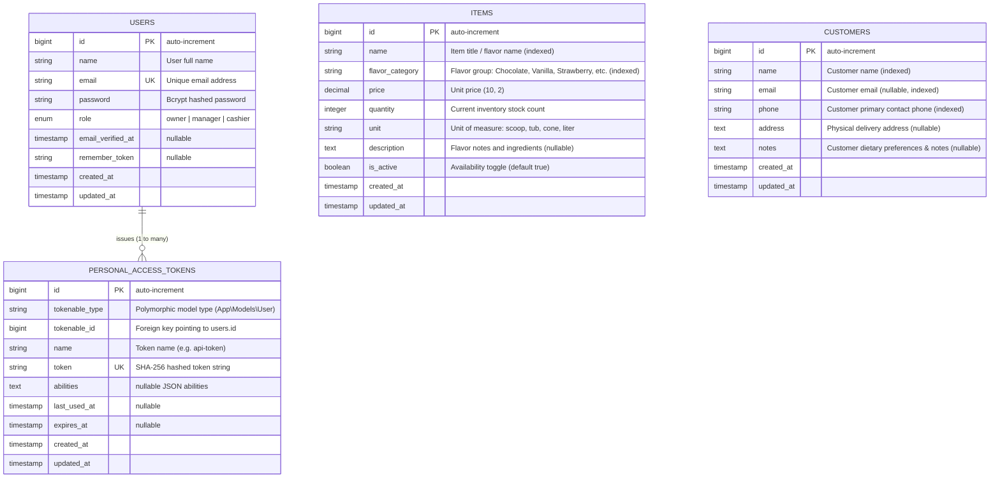

# Cramy Ice Cream Shop Management System - Database Design & ER Diagram

## 1. Overview
This document specifies the database schema and Entity-Relationship (ER) model for the Delivergate Ice Cream Shop backend.

The database is designed with high data integrity, strict typing, indexing on frequently queried columns (such as names, phone numbers, and categories for search optimization), and built-in support for token-based authentication (Laravel Sanctum).

---

## 2. Entity-Relationship (ER) Diagram (Mermaid Source)

---

## 3. Data Dictionary

### Table: `users`
| Column | Type | Constraints | Description |
|---|---|---|---|
| `id` | BIGINT UNSIGNED | Primary Key, Auto Increment | Unique user identifier |
| `name` | VARCHAR(255) | NOT NULL | User's full name |
| `email` | VARCHAR(255) | NOT NULL, UNIQUE | User login email address |
| `password` | VARCHAR(255) | NOT NULL | Bcrypt hashed password |
| `role` | VARCHAR(50) | NOT NULL, Default: `'cashier'` | One of: `owner`, `manager`, `cashier` |
| `remember_token` | VARCHAR(100) | NULL | Laravel authentication remember token |
| `created_at` | TIMESTAMP | NULL | Record creation timestamp |
| `updated_at` | TIMESTAMP | NULL | Record last update timestamp |

### Table: `items`
| Column | Type | Constraints | Description |
|---|---|---|---|
| `id` | BIGINT UNSIGNED | Primary Key, Auto Increment | Unique item identifier |
| `name` | VARCHAR(255) | NOT NULL, INDEXED | Ice cream flavor / item name |
| `flavor_category` | VARCHAR(100) | NOT NULL, INDEXED | Category (e.g., Chocolate, Vanilla, Strawberry) |
| `price` | DECIMAL(10,2) | NOT NULL | Selling price per unit |
| `quantity` | INT | NOT NULL, Default: 0 | Available stock in inventory |
| `unit` | VARCHAR(50) | NOT NULL, Default: `'scoop'` | Unit of measure (`scoop`, `tub`, `cone`) |
| `description` | TEXT | NULL | Description and taste profile |
| `is_active` | BOOLEAN | NOT NULL, Default: TRUE | Active status |
| `created_at` | TIMESTAMP | NULL | Creation timestamp |
| `updated_at` | TIMESTAMP | NULL | Update timestamp |

### Table: `customers`
| Column | Type | Constraints | Description |
|---|---|---|---|
| `id` | BIGINT UNSIGNED | Primary Key, Auto Increment | Unique customer record identifier |
| `name` | VARCHAR(255) | NOT NULL, INDEXED | Customer's full name |
| `email` | VARCHAR(255) | NULL, INDEXED | Contact email address |
| `phone` | VARCHAR(50) | NOT NULL, INDEXED | Contact phone number |
| `address` | TEXT | NULL | Shipping or billing address |
| `notes` | TEXT | NULL | Order preferences, allergies, or notes |
| `created_at` | TIMESTAMP | NULL | Creation timestamp |
| `updated_at` | TIMESTAMP | NULL | Update timestamp |

### Table: `personal_access_tokens`
| Column | Type | Constraints | Description |
|---|---|---|---|
| `id` | BIGINT UNSIGNED | Primary Key, Auto Increment | Unique token record identifier |
| `tokenable_type` | VARCHAR(255) | NOT NULL | Polymorphic model class (`App\Models\User`) |
| `tokenable_id` | BIGINT UNSIGNED | NOT NULL | Polymorphic user ID |
| `name` | VARCHAR(255) | NOT NULL | Token descriptor (e.g., `api-token`) |
| `token` | VARCHAR(64) | NOT NULL, UNIQUE | SHA-256 hash of the plain-text token |
| `abilities` | TEXT | NULL | Serialized JSON capabilities |
| `last_used_at` | TIMESTAMP | NULL | Last time the token was authenticated |
| `expires_at` | TIMESTAMP | NULL | Token expiration date |
| `created_at` | TIMESTAMP | NULL | Issue timestamp |
| `updated_at` | TIMESTAMP | NULL | Update timestamp |
